# Tutorial: Human doxorubicin organoid example

This tutorial demonstrates a complete run of the current **R-ODAF-Shiny** workflow using the bundled **human doxorubicin organoid** example dataset from the published study by **Rodrigues et al., 2022**.

The goal of this tutorial is to show how a user can move from loading an example dataset to reviewing quality control, differential expression, gene-level visualisation, optional pathway analysis, session-based result storage, and summary export.

The tutorial reflects the current app structure and the current bundled screenshots.

Key features of the tool:

- bundled example-data loading
- support for **up to 5 datasets in one session**
- fixed **DESeq2-based** workflow
- **PCA & outlier** review
- **DE results** table and downloads
- merged **Gene expression** tab
- **Top gene expression**, **Average expression**, and **Volcano plot**
- **Results** tab with session-only DEG storage
- **Results Comparison**
- optional **Pathway analysis**
- **Summary** and reproducibility downloads

---

## Step 1 – Load the example dataset

Open the **Analysis** tab and start with the bundled example dataset.

For this tutorial:

1. Set **Number of datasets** to `1`
2. Under **Dataset 1**, keep or edit the dataset name
3. Set **Organism (for gene symbols)** to `Human`
4. Tick **Use example dataset**

Because this dataset is bundled inside the app, the counts and metadata are loaded internally from the example files and do not need to be uploaded manually.

This step confirms that the example dataset has been selected correctly and that the analysis will use the human annotation setting for gene symbol mapping.

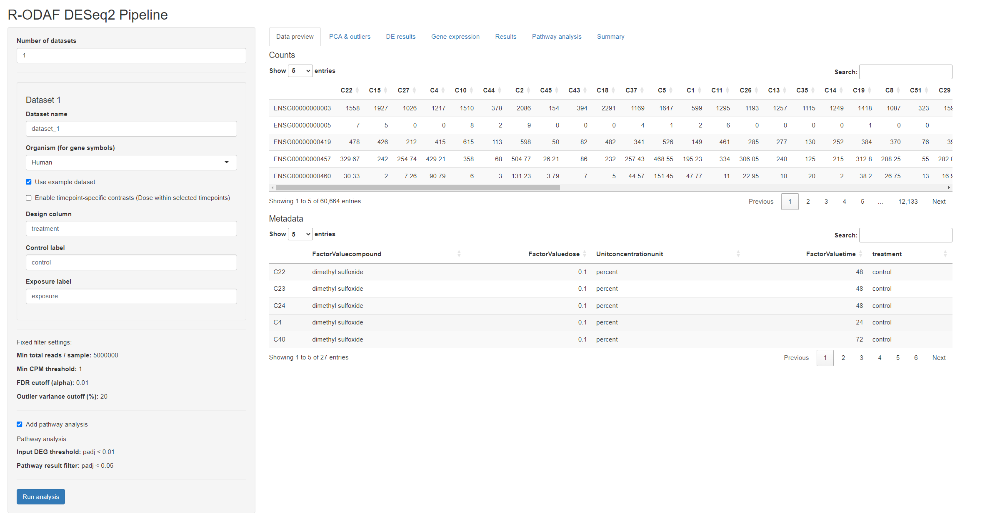

---

## Step 2 – Set the dataset and analysis options

After loading the bundled example dataset, review the dataset settings in the left panel.

Important settings visible here include:

- **Dataset name**
- **Organism**
- **Use example dataset**
- the option to enable **timepoint-specific contrasts**
- the optional **Add pathway analysis** setting

Pathway analysis is **optional**. If enabled, the app performs downstream enrichment through **enrichR** using three pathway libraries:

- **KEGG**
- **WikiPathways**
- **Reactome**

The pathway settings shown in the app indicate that:

- the input DEG threshold is **padj < 0.01**
- the pathway result filter is **padj < 0.05**

If pathway analysis is not enabled before running the analysis, the **Pathway analysis** tab will not appear later.

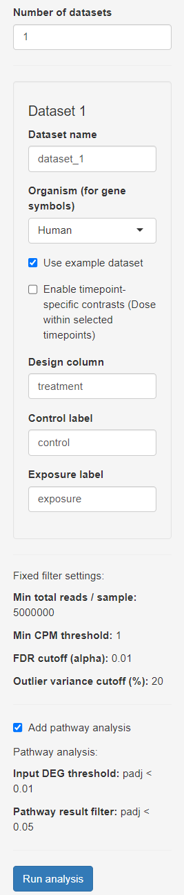

---

## Step 3 – Define the comparison and inspect the data preview

This example uses a standard two-group comparison.

Leave:

- **Enable timepoint-specific contrasts (Dose within selected timepoints)** = **unchecked**

Then set or confirm:

- **Design column** = `treatment`
- **Control label** = `control`
- **Exposure label** = `exposure`

This is important because the example uses the metadata column named `treatment` to define the comparison, with `control` as the reference group and `exposure` as the case group.

The screenshot for this step also shows the **Data preview** tab, where you should inspect both input tables.

### Counts table
This should contain:

- genes in rows
- samples in columns

### Metadata table
This should contain:

- samples in rows
- study variables in columns

At this stage, always confirm that the sample IDs in the metadata match the sample columns in the counts table. This is essential for a successful run.

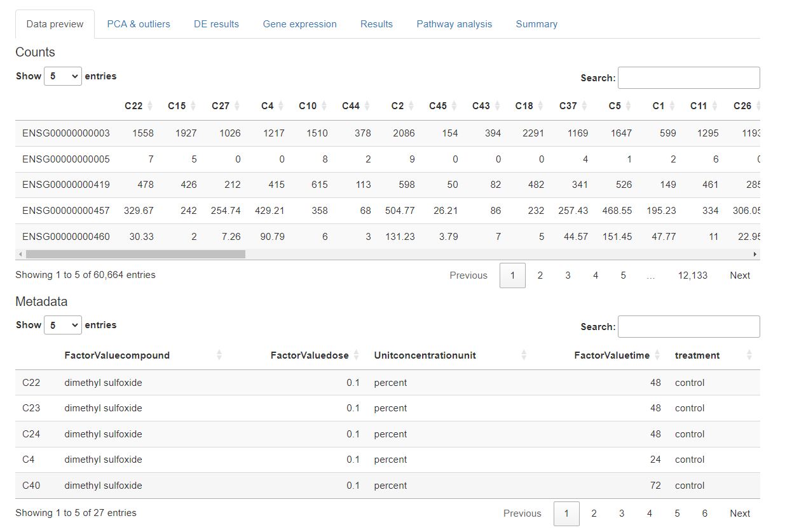

---

## Step 4 – Run the analysis

After confirming the dataset settings, click **Run analysis**.

Once clicked, the app starts the fixed R-ODAF workflow and shows a progress window indicating that the pipeline is running. This confirms that the selected dataset settings, design column, labels, and optional analysis settings are being processed.

At this stage, the app runs the core workflow behind the scenes, including:

- reading the counts and metadata
- checking sample overlap
- applying the fixed R-ODAF filters
- running the locked **DESeq2** workflow
- preparing the PCA, DEG, gene-expression, results, and summary outputs
- running pathway analysis as well, if the pathway option was enabled before starting

This step confirms that the analysis has been launched successfully and that the app is processing the selected dataset.

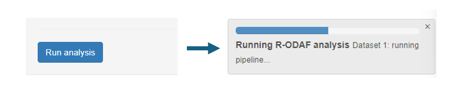

---

## Step 5 – Review PCA & outliers

After the run finishes, open the **PCA & outliers** tab.

This tab contains three key parts:

- **PCA before outlier removal**
- **outlier log**
- **PCA after outlier removal**

### PCA before outlier removal

The first PCA plot is used to assess:

- whether control and exposure groups separate
- whether samples cluster as expected
- whether any samples appear unusual relative to the rest

Use this view to ask:

- Do the control and exposure samples show a visible shift?
- Are any samples far away from the rest of their group?
- Is the overall structure biologically plausible?

This is an important first quality-control checkpoint because it provides a quick overview of the global structure of the dataset after the fixed workflow has been applied.

### Outlier log and PCA after outlier removal

The same tab also reports whether any samples were removed by the outlier procedure and shows the PCA again after this step.

In this example, **no outliers were removed**, so the before and after PCA views remain effectively the same.

This is still an important part of the workflow because, in other datasets, this section determines whether the final downstream analysis is based on the full dataset or on a cleaned dataset after sample exclusion.

If samples are removed in your own run, they should be reviewed carefully before biological interpretation.

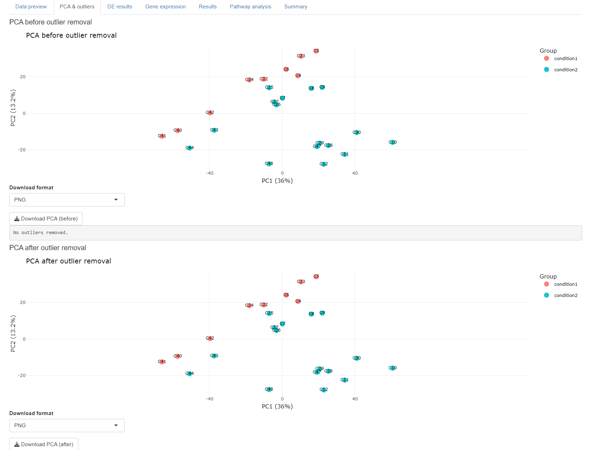

---

## Step 6 – Review the DE results table

Open the **DE results** tab.

This tab provides the main differential expression output of the run.

At the top of the tab, the app reports a summary including:

- **Dataset**
- **Dataset tag**
- **Organism used for gene symbols**
- **Design column**
- **Contrast**
- **Samples used**
- **Total genes tested**
- **Final DEGs**

Below that is the interactive **DEG table**, which contains one row per significant DEG and includes columns such as:

- `GeneID`
- `GeneSymbol`
- `baseMean`
- `log2FoldChange`
- `lfcSE`
- `stat`
- `pvalue`
- `padj`

This tab also provides several download options, including:

- **Download DEGs**
- **Download Norm Counts**
- **Download FULL results**
- **Download VST**
- **Download genes tested**
- **Download samples used**

These outputs are central for both interpretation and reproducibility.

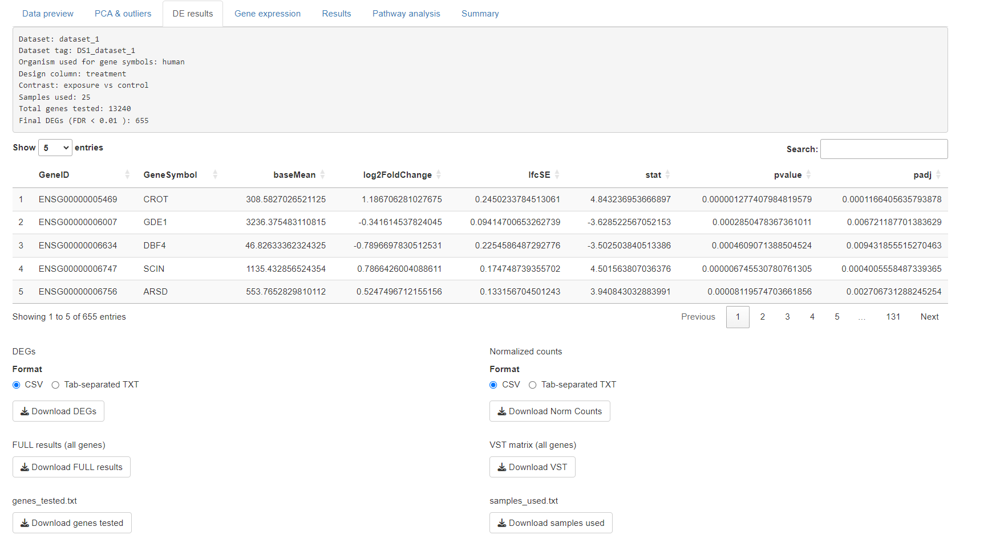

---

## Step 7 – Explore gene-level visualisation

Open the **Gene expression** tab.

This tab contains three sub-tabs:

- **Top gene expression**
- **Average expression**
- **Volcano plot**

Together, these views help the user move from a DEG table to more interpretable gene-level visualisation.

### Step 7a – Top gene expression

The **Top gene expression** sub-tab shows per-gene expression distributions using boxplots with overlaid sample points.

Controls available here include:

- **Total DEGs to consider**
- **Gene range**
- **Gene labels** (`Ensembl ID` or `Gene symbol`)

This view is especially useful because it shows not only the group-level difference, but also the spread of individual samples within each condition.

This helps users judge whether a DEG is driven by a stable group shift or by only a few samples.

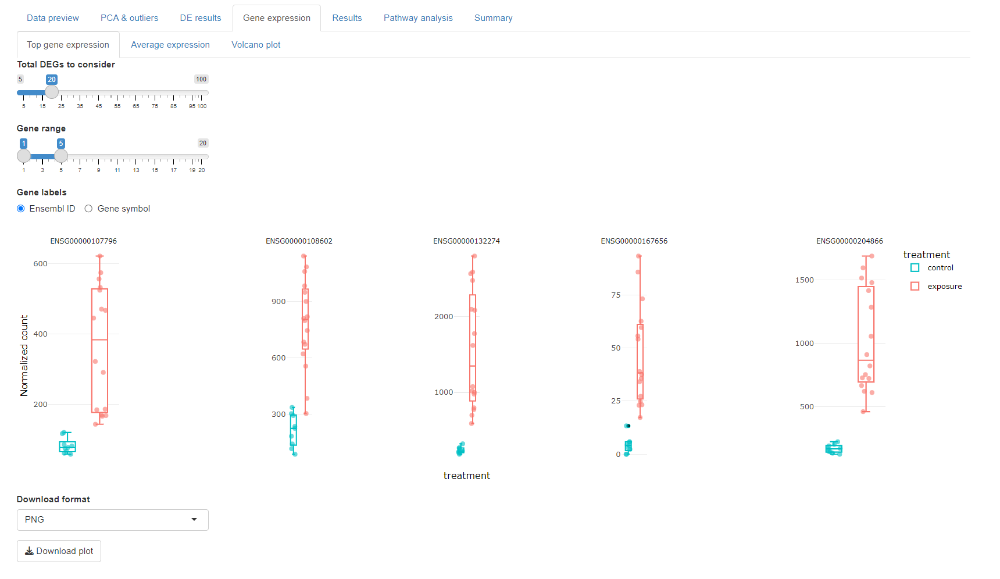

### Step 7b – Average expression

The **Average expression** sub-tab shows mean expression values for selected top-ranked DEGs across groups.

Controls available here include:

- **Total DEGs to consider**
- **Gene range**
- **Gene labels** (`Ensembl ID` or `Gene symbol`)

This view is useful for quickly comparing average expression differences between control and exposure for a selected gene subset.

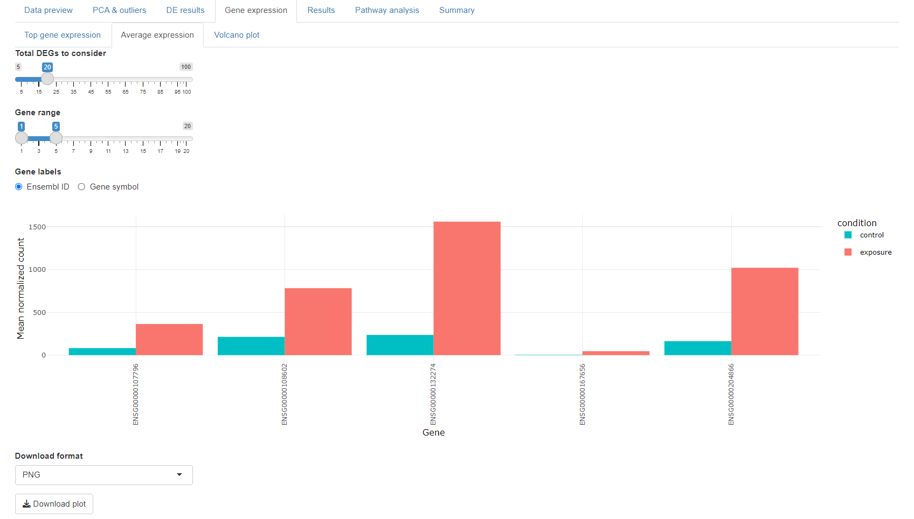

### Step 7c – Volcano plot

The **Volcano plot** sub-tab shows the full differential expression result as a volcano plot.

It includes:

- **Gene label** selection (`Ensembl ID` or `Gene symbol`)
- **Download format**
- **Download plot**

In this app, the volcano categories are based on **adjusted p-value** and the direction of the fold change:

- **Up**: `padj < 0.01` and `log2FoldChange > 0`
- **Down**: `padj < 0.01` and `log2FoldChange < 0`
- **Not significant**: everything else

So a gene is considered **not significant** if:

- `padj` is missing, or
- `padj >= 0.01`, or
- `log2FoldChange` is missing

The dashed horizontal line represents the statistical threshold used in the app.

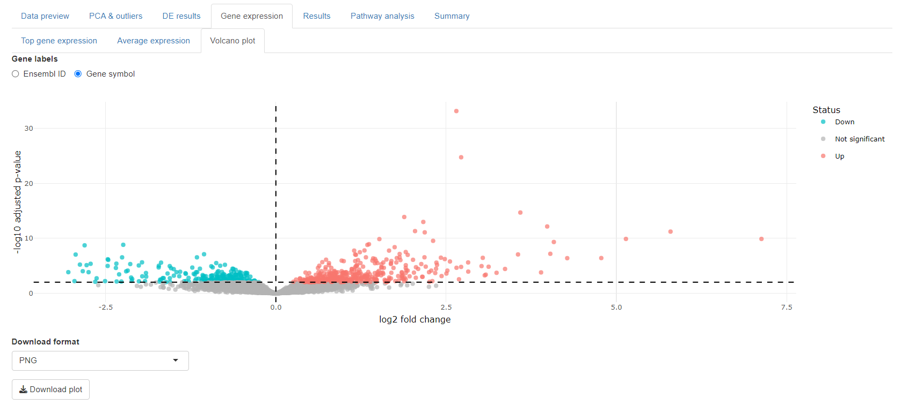

---

## Step 8 – Review stored gene-level results and run comparisons

Open the **Results** tab.

This tab has two separate functions.

### Step 8a – Results (session only)

The upper table stores DEG results from analyses performed during the **current session only**.

This means:

- the results are stored in an in-memory SQL table
- no persistent SQL file is written to disk
- the stored results are cleared when the app closes

This section is still useful even when **Results Comparison** is available, because it serves as the internal DEG archive that comparison queries use. It also allows users to inspect all stored gene-level results directly.

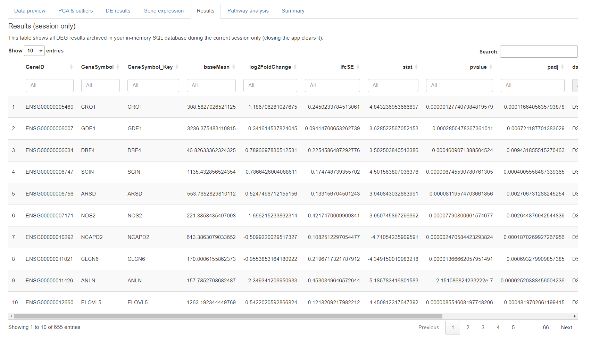

### Step 8b – Results Comparison

The lower section supports comparison of two stored analyses using the archived DEG results.

The comparison controls include:

- **Study A**
- **Study B**
- **Discovery Question**
- **Run Discovery Query**

Available comparison questions include:

- **Shared DEGs (A ∩ B)**
- **Shared, same direction (Concordant)**
- **Shared, opposite direction (Discordant)**
- **Unique to Study A (A \\ B)**
- **Unique to Study B (B \\ A)**
- **Largest effect-size shift (|FC_A - FC_B| ≥ 1)**

The **Largest effect-size shift** query identifies genes that are present in both analyses but show a substantial difference in fold change magnitude between the two studies.

In the screenshot shown here, **Study A** and **Study B** are both set to the same dataset. Because of that, the comparison is aligned to itself, so the matching genes return the same fold changes and the difference columns such as **DeltaFC** and **AbsDeltaFC** are zero. This is expected for this demonstration example.

This comparison feature becomes especially useful when multiple datasets, doses, or filtered analysis runs are performed in the same session.

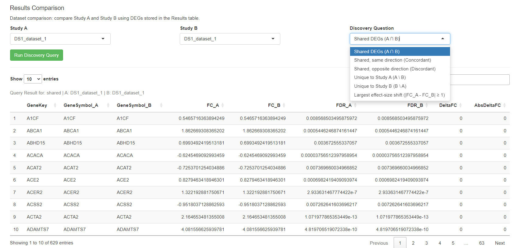

---

## Step 9 – Review pathway analysis

If **Add pathway analysis** was enabled before running the analysis, the **Pathway analysis** tab becomes available.

This tab provides:

- dataset name
- dataset tag
- input DEG threshold
- pathway result threshold
- total number of input genes
- libraries used
- number of significant pathway terms

Below the summary is the interactive pathway results table.

The table includes columns such as:

- `Term`
- `Overlap`
- `P.value`
- `Adjusted.P.value`
- `Odds.Ratio`
- `Combined.Score`
- `Genes`

This step provides a quick functional interpretation layer on top of the DEG results.

In the current app, pathway analysis is based on filtered DEG input only and is performed through **enrichR** using:

- **KEGG**
- **WikiPathways**
- **Reactome**

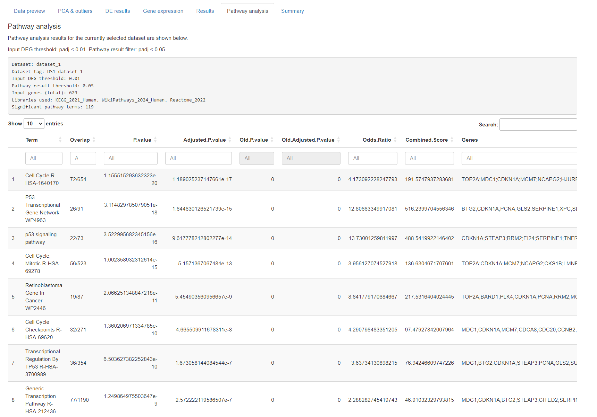

---

## Step 10 – Review the analysis summary and reproducibility outputs

Finally, open the **Summary** tab.

This tab provides a compact text summary of the complete run and includes information such as:

- dataset name
- dataset tag
- organism
- design column
- contrast
- fixed thresholds
- number of samples used
- number of samples removed
- total genes tested
- final DEGs
- pathway summary, if enabled
- run timing
- run stamp

This tab also includes download options for:

- **summary report**
- **sessionInfo**

These files are valuable for record keeping, reproducibility, and documenting exactly how the analysis was run.

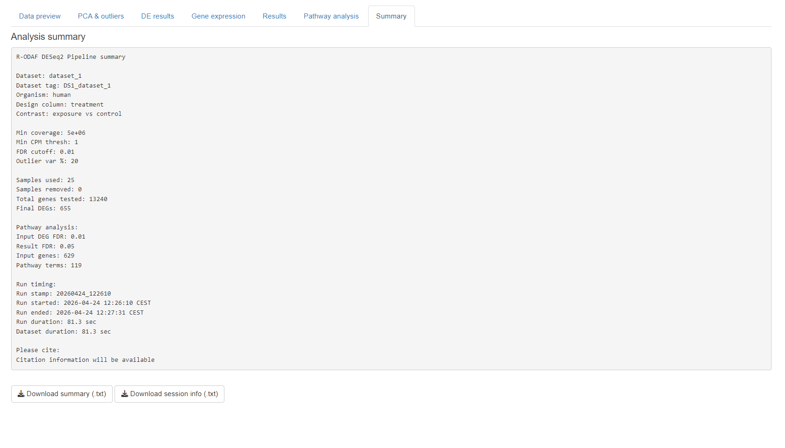

---

## Notes for analysing your own data

When using your own RNA-seq datasets in the app:

- provide a counts matrix with **genes in rows** and **samples in columns**
- provide metadata with **samples in rows**
- ensure that sample IDs match exactly between counts and metadata
- choose the correct organism for gene symbol mapping
- use the exact metadata column name that defines your comparison
- use the exact group labels present in your metadata
- enable pathway analysis before running if you want pathway results included

The app supports **up to 5 datasets in one session**, which makes it possible to perform multiple runs and use the comparison tools without restarting the app.

---

## End of tutorial

This tutorial demonstrated the current R-ODAF-Shiny workflow using the bundled **human doxorubicin organoid** example dataset from **Rodrigues et al., 2022**.

By completing these steps, the user is taken through:

- loading the bundled example data
- setting the dataset and analysis options
- defining the comparison and reviewing the preview tables
- starting the analysis and monitoring progress
- inspecting PCA and outlier handling
- examining DE results
- exploring gene-level expression views
- using the session-only results archive
- running DEG comparison queries
- reviewing optional pathway analysis
- exporting summary and reproducibility information

The same workflow can now be applied to your own RNA-seq datasets within the same app structure.